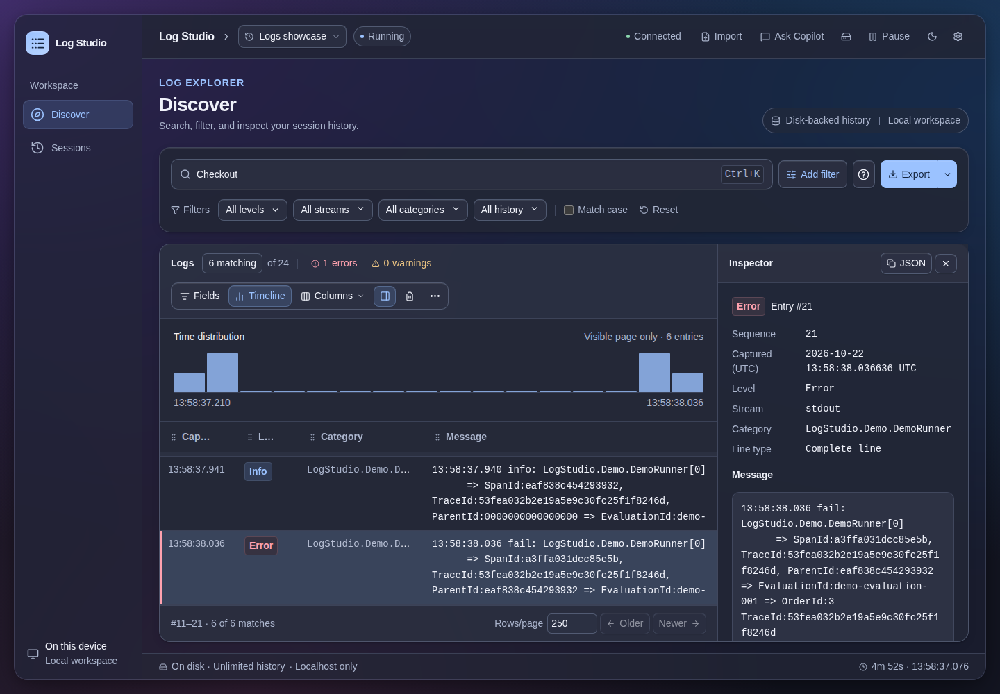
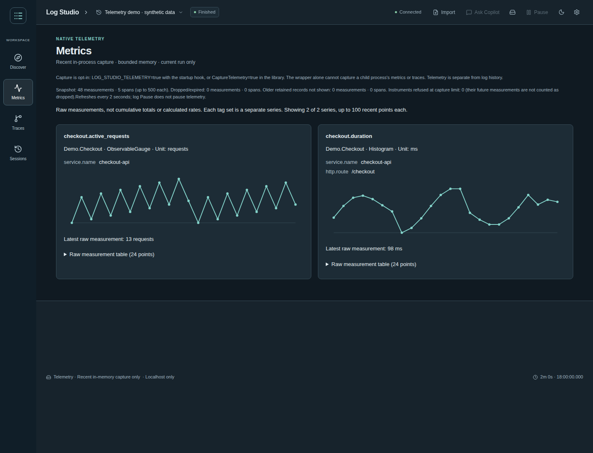
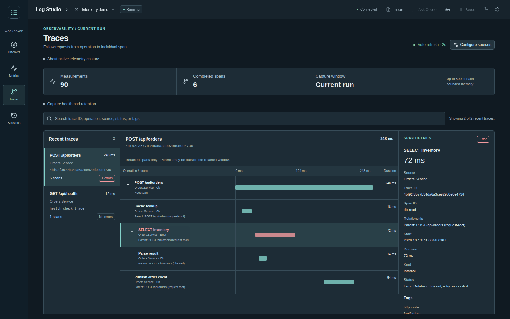
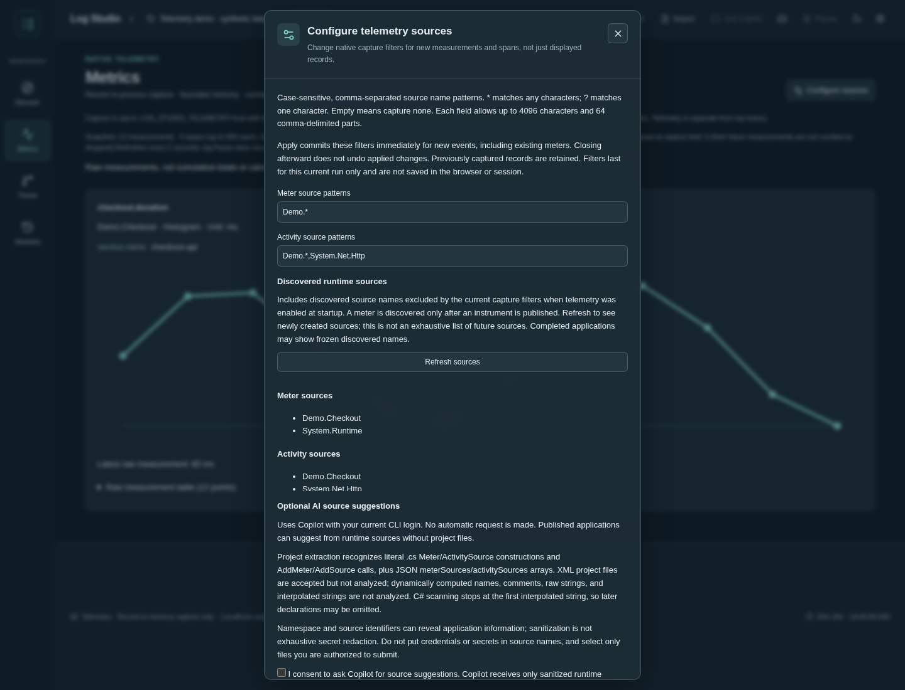
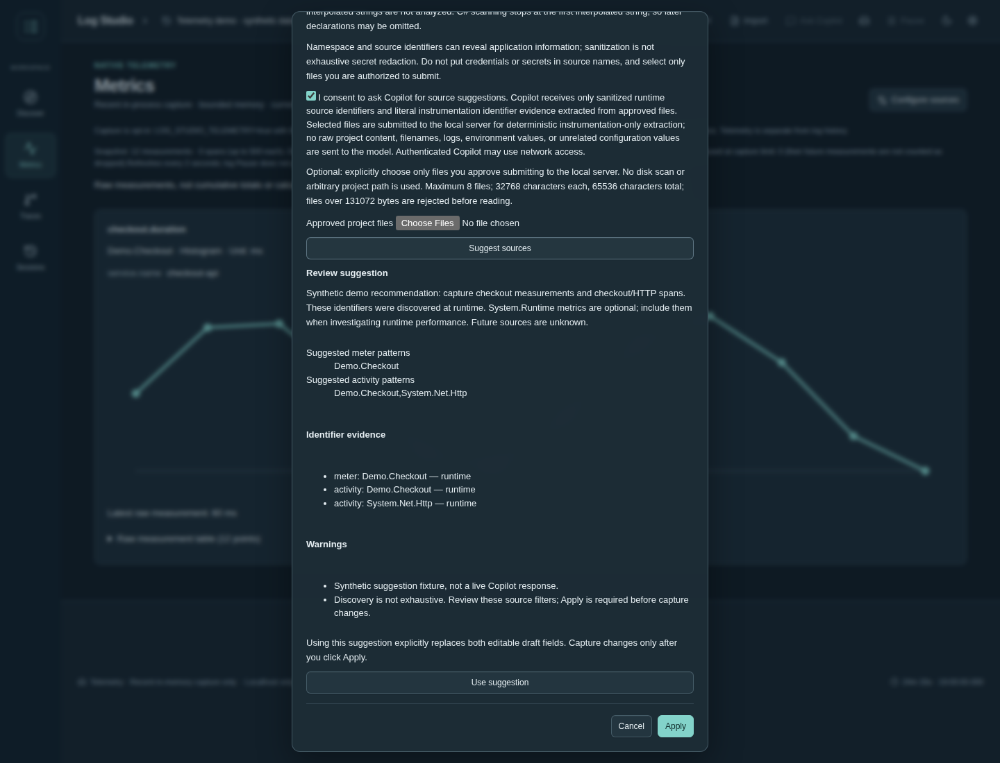
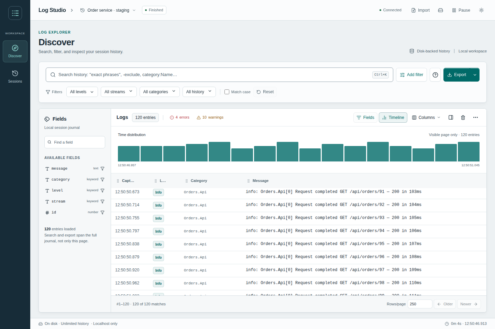
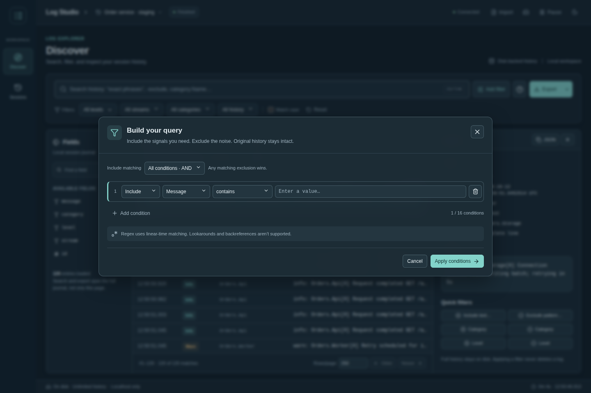
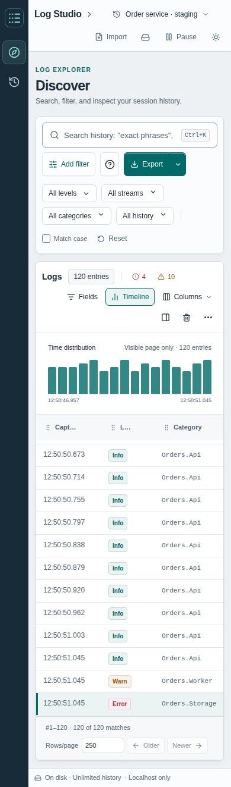

# Log Studio

**Stop scrolling. Start finding.**

Turn your C# / .NET app or console command into a live, searchable log workspace.
Same command. No app changes. One local browser tab.

- **Catch it live** — tail output, search history, and filter the noise.
- **Find the why** — inspect entries, highlight matches, and build include/exclude filters.
- **Keep the context** — save sessions, import runs, and export JSONL.
- **Stay local** — embedded, offline-ready viewer with disk-backed history.

[Get started](#quick-start-wrapper-recommended) · [Search tools](#search-tools) · [Ask Copilot](#optional-copilot-log-chat)

## See it in action



**From noise to the exact entry.** Search and filter a session, then inspect a log without leaving the results.
The optional timeline shows the **visible page only**, not the full session.

### Metrics



**See the measurements.** Inspect separate tagged series and recent raw values.
Shown with synthetic demo telemetry, not production data.

### Traces



**Follow the request.** Inspect completed spans, parent relationships, and error details.
Shown with synthetic demo telemetry, not production data.

### Configure telemetry sources



**Choose what to capture.** Configure metric and trace sources independently, including sources
discovered outside the current filters. Shown with synthetic demo data.

### AI-assisted configuration



**Discover, suggest, review.** Optional Copilot suggestions explain recommended sources.
Choose **Use suggestion**, then **Apply**—configuration is never applied automatically.
Shown with a synthetic suggestion fixture, not a live Copilot response.

<details>
<summary>More views: light mode, filters, and mobile</summary>

### Light mode



**Same workspace, lighter look.** Switch between light and dark themes.

### Focused filters



**Less noise. More signal.** Combine include/exclude conditions to narrow down your logs.

### Mobile view



**A compact view for smaller screens.** Browse the workspace in a responsive layout.

</details>

<details>
<summary>Under the hood</summary>

The primary entry point is a **NuGet-packaged .NET wrapper tool**: keep using your existing command,
without changing the application, logging providers, configuration, or repository.
History lives in private temporary files; neither the capture process nor the browser keeps the entire run in RAM.
All browser assets are embedded and work offline.

The workspace follows the **OpenSearch Dashboards Discover** interaction model: compact application
chrome, a session switcher, query/filter bar, document results, and optional field browser,
timeline, and inspector. The distribution is explicitly **visible-page-only**, not a fabricated full-history
histogram. It uses the compatible React 19 stack, not a copied OpenSearch Dashboards server.
`@opensearch-project/opensearch` is a Node client, not UI components, and is not required.
The published OUI library requires an older React/TypeScript toolchain; it is not forced into
this application with ignored peer dependencies.

The frontend uses **React + TypeScript**, **Radix UI** accessible controls, **TanStack Table**,
and **Lucide** icons. **dnd-kit** provides pointer, touch and keyboard column dragging.
Menus, popovers, and the condition dialog support keyboard navigation and
focus management. Columns can be resized, hidden, moved, and reset without changing server paging.
There is no runtime CDN, Node server, or accumulating client-side query cache.

This is a standalone workspace, independent of the application's repository. Medeina is an
optional compatibility example / test, not a package or runtime dependency.

</details>

## Appearance

The log table is the workspace, not a dashboard below oversized counters. A compact header
switches sessions and shows run state; matching counts and actionable error/warning counts sit
beside the results. **Fields**, **Timeline**, and the **Inspector** toggle on demand and start
closed. Selecting a row opens its inspector. The initial columns focus on capture time, level,
category, and message; sequence ID and stream remain available in **Columns**.
**Explorer options** holds Wrap long lines, Follow newest entries, Clear view, and Refresh.

Opaque surfaces, fine separators, compact controls, and readable monospace logs replace the
previous glass dashboard. Light and Dark Mode use the Clawpilot palette. System typography,
keyboard navigation, resize/reorder grips, and per-query filter chips remain available.

Open **Settings** (the gear in the header) to choose the UI font and base size (12–18 px),
plus an independent monospace font, size (10–24 px), and line spacing for log messages in
the table and inspector. Controls, headings, menus, and dialogs scale with the UI size.
Changes apply immediately with previews; **Reset typography** restores the original fonts
and sizes without changing your query, session, or theme.
Fonts use installed local fallbacks and do not require downloads. Typography preferences
are saved in browser storage for the current server origin, including its port, and survive
reloads. A run on a different port has separate settings. If storage is blocked, changes
still apply to the current tab and Settings shows a warning.

Without a `clawpilotTheme` URL override, appearance follows system changes automatically.
The mode button selects a manual light / dark override; reload without that query parameter to
return to automatic appearance. Increased-contrast and reduced-transparency preferences remove
blur and use opaque, stronger-bordered surfaces. Reduced-motion disables control transitions.
Browsers without backdrop-filter support use opaque surfaces.

## Quick start: wrapper (recommended)

Build and install from source with the native installer for your operating system.
Prerequisites: the **.NET 10 SDK** selected by `global.json` (10.0.301 or a compatible later
10.0 feature band), **Node.js 22.12+**, and npm. Use the x64 or ARM64 installers matching
your computer from [.NET downloads](https://dotnet.microsoft.com/download/dotnet/10.0)
and [Node.js downloads](https://nodejs.org/en/download). Missing prerequisites produce setup
instructions; Log Studio does not silently install system software or change your shell.

**macOS / Linux — Bash:**

```bash
git clone https://github.com/matanelcohen/LogStudio.git
cd LogStudio
./install.sh
logstudio --open -- dotnet run --project ./path/to/App.csproj
```

**Windows — PowerShell (no Bash, WSL, or administrator shell required):**

```powershell
git clone https://github.com/matanelcohen/LogStudio.git
cd LogStudio
.\install.ps1
logstudio --open -- dotnet run --project .\path\to\App.csproj
```

If your Windows execution policy blocks scripts, use a process-only override rather than
changing the machine policy:

```powershell
powershell -NoProfile -ExecutionPolicy Bypass -File .\install.ps1
```

PowerShell 7 is also supported, including on macOS / Linux (`pwsh -NoProfile -File ./install.ps1`).
Both entry points resolve paths relative to the script, so they can be invoked from another
directory or a clone path containing spaces.

The installer restores, builds, runs frontend and backend tests, packs both NuGets, and installs the fresh tool
**globally for your user**. It can be invoked from any directory. It does not modify shell profiles,
application source, or unrelated global tools. Re-running it replaces the existing Log Studio
installation even when the package version is unchanged, using a fresh temporary NuGet cache.
By default it tries cached dependencies first, so a fully cached build does not fail because
NuGet.org's vulnerability endpoint is unavailable. Cache-only verification is explicitly reported;
if cached restore fails, the configured online source is tried without suppressing its errors.
In default cache-first mode only, a failed configured restore then tries NuGet's official
HTTPS v2 feed. This supports a fresh dependency cache when the v3 service index is unreachable.
The fallback does not offer vulnerability auditing and is reported explicitly. Strict
`--online` / `-Online` never automatically falls back or suppresses audit errors.
The React build requires Node.js **22.12+** and npm. The installed `logstudio` tool and NuGets
require only .NET; Node is never needed to view logs or run a wrapped command.

```bash
# Project-local tool instead of global installation:
./install.sh --local

# If NuGet.org is unavailable and dependencies are already cached:
./install.sh --offline
./install.sh --local --offline

# Require online restore and NuGet's vulnerability lookup instead:
./install.sh --online

# Choose a specific feed when required by your network:
./install.sh --nuget-source https://www.nuget.org/api/v2/
```

```powershell
.\install.ps1 -Local
.\install.ps1 -Offline
.\install.ps1 -Local -Offline
.\install.ps1 -Online
.\install.ps1 -NuGetSource https://www.nuget.org/api/v2/
```

The temporary install cache is removed on exit. Offline restore requires the existing test
dependencies and targeting packs; it cannot download a missing dependency and does not perform
an online package-vulnerability check. New computers normally need internet access for their
first install. Neither script disables TLS certificate validation or removes dependencies to
make a restore succeed.

The [installer CI](.github/workflows/install.yml) exercises clean Windows and macOS installs.
Use its Windows job as the native Windows validation result; running PowerShell on macOS alone
does not verify Windows-specific execution.

## Optional Copilot log chat

Click **Ask Copilot** in the header to open a chat panel on the left, alongside the log results.
The panel focuses on the conversation: your messages, Copilot's replies, and a composer fixed
at the bottom, without introductory or context-report paragraphs. Press **Enter** to send,
or **Shift+Enter** for a new line.
Chat uses the **full selected session**, including saved/imported sessions, regardless of visible
filters or paging. The feature is off until you explicitly connect and send a question.

1. Install the current [GitHub Copilot CLI](https://docs.github.com/en/copilot/how-tos/copilot-cli/set-up-copilot-cli/install-copilot-cli)
   on the **machine running Log Studio**, and run `copilot login` in a terminal. A Copilot entitlement
   and internet connection are required; the older `gh copilot` extension is not supported.
2. Ensure `copilot` is on Log Studio's `PATH` (`copilot.exe` on Windows). Alternatively, set
   `LOG_STUDIO_COPILOT_PATH` to the absolute executable path before launching Log Studio.
   Windows requires the native executable, not a `.cmd`/PowerShell shim. Restart Log Studio after changing it.
3. Select the session you want to discuss, open **Ask Copilot**, and click
   **Connect local Copilot**. Connecting only checks the CLI version; it does not send logs.
4. Ask your question—there is no approval checkbox. The full conversation stays visible; follow-up
   questions include up to three recent question/answer pairs. **New chat** clears the conversation and draft;
   closing and reopening chat starts over. Switching sessions resets the conversation.

**Local CLI does not mean local inference.** Questions, session log text read by Copilot, and recent conversation are
sent to GitHub Copilot's service using your existing CLI authentication. Log text is **not automatically
redacted**: do not send credentials, secrets, personal data, or other sensitive information.
The bridge uses an isolated temporary CLI configuration, reusing only authentication state and the
OS credential store (or existing authentication environment variables). Temporary state is removed
after each request. Clearing browser chat does not delete provider history.
No authentication tokens are entered into or stored by the chat UI.
The rest of Log Studio remains fully offline and does not require Copilot.

Every question streams all stored records of the selected session into a private temporary JSONL file
that Copilot can read. There is no 100-record limit or message/context truncation in this file.
This includes records hidden by the viewer's capacity setting, but records deleted with **Clear logs**
are unavailable. Each question gets a fresh file containing newly captured logs; its contents stay
stable while Copilot answers. Files are deleted after the request, including on failures.
Copilot may read relevant portions of large files rather than load every record into its context window.
Questions are limited to 2,000 characters; answers to 16,000.
Answers cite sequence IDs but can be wrong—verify them against the original records.

The bridge launches the CLI directly without a shell, passes context over standard input, uses a
fresh owner-private temporary working/configuration directories, and limits available tools to the
file-view tool for reading the session file. All other model tools are unavailable.
Reads use the CLI's default working-directory path restrictions in an isolated directory containing
only `session.jsonl`. Automatic access to the system temporary directory is disabled; CLI
authentication/configuration lives outside the log working directory. No all-paths or all-tools
permission is granted.
Custom instructions, hooks, built-in MCP servers, and inherited permission/provider opt-ins are disabled;
user plugins, extensions, and MCP configuration are not copied into the isolated configuration.
Remote session/export features are disabled (inference still uses Copilot's service).
Browser requests cannot choose an executable or a file path. Current CLI support for these read-only
flags is required; unsupported versions fail closed.
These are Copilot CLI permission controls, not an operating-system sandbox.
Only one Copilot request runs at a time. Connection checks time out after 10 seconds; questions after
two minutes. Closing is disabled while a request runs; stopping Log Studio cancels its owned CLI process.

## Saved session manager

The wrapper now saves named run histories for reopening. Click **Sessions** (or the History icon
in the application rail) to choose the current run or a previous run. Each entry shows its name,
date/time, entry count and exit state. **Run parameters** expands the command, arguments, working
directory and session ID. The search box matches names, dates, command names and argument values.
New runs get a lowercase adjective–animal name such as `digital duck` by default,
using the offline .NET package RandomFriendlyNameGenerator. If a name is already used
in the process or saved catalog, a numeric suffix is added (for example, `digital duck 2`).
Use `--name "My investigation"` to choose a name at startup, or **Sessions → Rename** to change it later.

Histories are saved under the current user's local application-data folder at `LogStudio/sessions`
(typically `~/Library/Application Support/LogStudio/sessions` on macOS). To isolate another catalog:

```bash
LOG_STUDIO_SESSIONS_DIRECTORY="/absolute/private/path" logstudio --name "My run" -- dotnet run
```

Saved journals/indexes and metadata are owner-private and remain across process restarts.
Temporary capture files are still removed on graceful close. Only runs saved **after this feature
was installed** are available; earlier deleted temporary histories cannot be recovered.
Selecting a prior session routes search, paging, level selection and export to that history,
without changing or stopping the current command. Clear logs affects only the selected session.
Cleared saved sessions retain their name/date/parameter metadata with zero log entries.

The manager includes catalog counts, refresh, per-session export, **Rename**, and confirmed
**Delete**. Current and saved sessions can be renamed; names may contain 1–128 characters.
Renaming updates the display and saved metadata without changing the session ID or logs.
Delete removes that saved session's journal, seek index, and metadata; it does not stop or erase
the current run. Deleting the session you
are viewing returns the explorer to the current run. Current-run deletion is disabled:
use **Clear logs** to delete its captured entries.

Common secret flag names (password, secret, token, API key, authorization, credential) are redacted
in the saved parameter list. This is best-effort: positional secrets and log text are not
automatically redacted. Saved files are not encrypted, and disk usage grows until histories are
cleared or deleted through the session manager.

Library attachment is ephemeral by default. Set `SaveSession=true`, `SessionsDirectory`,
`RunCommand`, `RunArguments`, and `RunWorkingDirectory` on `ConsoleLogViewerOptions` to opt in.

## Import and export

Use the arrow beside **Export** to choose between:

- **Matching records (.jsonl):** streams all records matching the current search, conditions,
  levels, stream, category, time window, and snapshot bounds—not just the visible page.
- **Portable session bundle (.zip):** streams the selected session's complete retained history,
  independent of search or page filters, plus its name, dates, exit state, command, redacted
  arguments, and working directory. Session cards have the same bundle-export action.
  A running session is exported as a point-in-time snapshot, not a continuing subscription.

Click **Import** in the header (or **Sessions → Import**) and choose or drop a `.logstudio.zip`, `.zip`, `.jsonl`, or `.ndjson`
file. Optionally supply a session name, then click **Import and open**. The dialog reports
actual upload progress followed by server-side validation/index rebuilding. A successful import
opens the new saved session; failures remain visible and leave existing histories unchanged.
If the connection is interrupted, refresh Sessions before retrying, because the server might
have finished saving the upload before its response was lost.

### Portable format

Version 1 bundles are ZIP archives containing exactly:

- `session.json`: `{ "formatVersion": 1, "session": { ...session details... } }`
- `logs.jsonl`: one Log Studio entry per line.

No directory entries, extra files, duplicate ZIP entries, or uploaded seek indexes are accepted.
JSONL must use Log Studio's entry schema: positive `id`, ISO timestamp, `stream`
(`stdout`, `stderr`, or `viewer`), `severity` (`output`, `trace`, `debug`, `information`,
`warning`, `error`, or `critical`), nullable/string `category`, string `message`, and boolean
`isPartial`. This is not a general-purpose parser for arbitrary text/CSV/other vendors' JSON.

Each import gets a fresh session ID and a locally rebuilt disk index. Entry IDs are normalized
to `1..N`, so filtered JSONL exports with gaps can be imported reliably. Timestamps, messages,
stream, severity, category, and partial-line flags are preserved. Plain JSONL has no run
parameters; its dates derive from its records and it receives an adjective–animal name by default,
with the same collision handling as new runs.
Bundle imports preserve the exported name unless you supply a replacement.
Empty JSONL is rejected, while a bundle for a cleared/zero-entry session remains valid.

### Transfer limits and privacy

Uploads are limited to **256 MiB** per file; expanded bundle logs to **1 GiB**; the manifest
to **64 KiB**; and a JSONL line to **1,048,576 characters**. Each message may contain up to
65,536 characters and a category up to 512. These are import safety limits, **not a retention
cap** on captured logs or an export-size limit.

Upload staging, decompression, validation, and reindexing use private local disk and bounded
buffers; the server/browser does not load the whole log history into memory. A complete upload
is staged on disk before indexing, so allow space for both the upload and expanded history.
Failed staging is removed; a session is added to the catalog only after successful validation.
Downloads use the browser's native download handling rather than constructing a large Blob.

Exported files contain log text and run metadata and are **not encrypted**. Common secret flags
are redacted again on import, but positional secrets, paths, and log contents are not
automatically scrubbed. Review exports before sharing them. Importing never executes the
saved command. The viewer remains loopback-only, protected by its random session URL,
same-origin checks, and explicit action headers; no OpenSearch cluster or external service
is involved.

For manual build / packaging instead:

From this directory, build and pack:

```bash
cd frontend
npm ci
npm run build
npm test
cd ..
dotnet build LogStudio.sln -c Release
dotnet pack LogStudio.sln -c Release --no-build -o artifacts
dotnet tool install LogStudio.Tool \
  --tool-path ./artifacts/tool --configfile ./NuGet.Local.Config --version 0.1.0
```

The tool needs a .NET 10 or newer runtime.
Building this workspace and running its tests / host demo needs the .NET 10 SDK.
All C# projects target .NET 10 and use C# 14. The library and startup hook require a
.NET 10 or newer host; the wrapper can still capture commands running older runtimes.
The library has **no NuGet dependencies and no ASP.NET framework dependency**.

For a quick demonstration:

```bash
./artifacts/tool/logstudio --open --name Demo -- \
  dotnet run --project samples/LogStudio.Demo --no-build -c Release
```

The terminal prints `Log Studio: http://127.0.0.1:<port>/<session-secret>/`.
Open that URL if you omit `--open`. Each invocation gets its own port and session URL.

### Install globally and run from anywhere

The package is built locally, not published to NuGet.org. Install it from this workspace's
local feed (replace the configuration path with your clone's absolute path to install
from any directory):

```bash
dotnet tool install --global LogStudio.Tool --version 0.1.0 \
  --configfile /absolute/path/to/LogStudio/NuGet.Local.Config

logstudio --help
logstudio --open -- dotnet run --project ./path/to/ConsoleApp.csproj
logstudio --open -- dotnet run --project /absolute/path/to/ConsoleApp.csproj -- --your-argument=value
```

Use the lowercase command `logstudio` for portability. The wrapper inherits the caller's working
directory; relative project paths and application file reads resolve exactly as they would without
the wrapper. There is no need to `cd` to the Log Studio workspace.

If your shell cannot find it, add the standard .NET tools directory to your `PATH`:

```bash
export PATH="$HOME/.dotnet/tools:$PATH"
```

Add that line once to `~/.zshrc` on macOS to keep it across terminals. A global .NET tool is
installed for the current user, not system-wide, and does not require `sudo`.
On Windows, .NET tools normally live at `%USERPROFILE%\.dotnet\tools`.

### Shell aliases and Apple Silicon

The command after `--` must be a real executable, not a shell alias or function.
For example, a `dotnet-x64` alias defined in your terminal is not visible to `Process.Start`.
Prefer the actual executable path, or explicitly invoke the shell that owns the alias:

```bash
# Native .NET on Apple Silicon (when your application's native dependencies support ARM64):
logstudio --open -- dotnet run --project ./App.csproj -r osx-arm64

# Intel .NET, only if compatible x64 execution / Rosetta is available:
logstudio --open -- /usr/local/share/dotnet/x64/dotnet run --project ./App.csproj -r osx-x64

# Explicit shell execution can resolve aliases configured by your interactive shell:
logstudio --open -- zsh -ic 'dotnet-x64 run -r osx-x64'
```

`Bad CPU type in executable` is an OS / architecture failure, not a logging failure.
A wrapper or `-r osx-x64` cannot make an Intel SDK executable run without supported translation.
Use a native SDK and compatible application dependencies, or enable compatible Rosetta through
your normal macOS setup process. The installer does not install system software or accept licenses.

For a later packaged version:

```bash
dotnet tool update --global LogStudio.Tool \
  --configfile /absolute/path/to/LogStudio/NuGet.Local.Config
```

For local development when **repacking the same version**, NuGet can reuse cached package content.
Use a version bump when distributing updates; or uninstall this development tool and reinstall
with an isolated, fresh `NUGET_PACKAGES` directory to verify the new archive.

### Wrap any existing C# application

```bash
./artifacts/tool/logstudio --open -- dotnet run --project /path/to/ConsoleApp.csproj
./artifacts/tool/logstudio --open -- dotnet /path/to/MyApp.dll --input="value with spaces"
./artifacts/tool/logstudio --open -- /path/to/YourExecutable
```

The wrapper is not C#-specific: any command that writes to stdout / stderr can be viewed.
Only the optional in-process library / startup hook requires .NET.

### Medeina compatibility examples

Run these from the **Medeina-Service repository root**, replacing `<viewer>` with the absolute
path to this sibling directory:

```bash
<viewer>/artifacts/tool/logstudio --open --name TestConsole -- \
  dotnet run --project test/standalone/Medeina.Framework.Test.Console

<viewer>/artifacts/tool/logstudio --open --name SkillRunner -- \
  dotnet run --project test/standalone/Medeina.Framework.Test.SkillRunner -- \
  --skill-name=MySkill --skillset-name=MySkillset --skill-input:Key="value with spaces"
```

This also captures build output from `dotnet run`. To avoid build noise, build your application
normally and use `dotnet run --no-build` or wrap its built executable / DLL instead.
Keep the application's normal RID, authentication, skillsets, and configuration prerequisites;
the wrapper does not change or supply them.

For an already-built application, including an installed SkillRunner dotnet tool:

```bash
<viewer>/artifacts/tool/logstudio --open -- /path/to/TestConsole.exe
<viewer>/artifacts/tool/logstudio --open -- dotnet /path/to/SkillRunner.dll --skill-name=MySkill
<viewer>/artifacts/tool/logstudio --open -- Medeina.Framework.Test.SkillRunner --skill-name=MySkill
```

PowerShell example (use the call operator for a tool path containing spaces):

```powershell
$viewer = "C:\dev\LogStudio"
& "$viewer\artifacts\tool\logstudio.exe" --open --name SkillRunner -- `
  dotnet run --project test\standalone\Medeina.Framework.Test.SkillRunner -- `
  --skill-name=MySkill --skillset-name=MySkillset
```

### Lifetime and scripting

- By default, **after the child finishes, the viewer stays available** until Ctrl+C. The browser
  shows its exit code. This is particularly useful for short SkillRunner executions.
- Ctrl+C during a run stops the owned child process tree and exits with code `130`.
- Ctrl+C after a completed run closes the viewer and returns the original child exit code.
- In automation, use `--no-wait`: the wrapper exits when the child finishes, with the child's
  original exit code. Download logs before the viewer stops if you need a saved copy.
- Standard input is inherited. Interactive `Console.ReadLine` / normal console input works.
- Arguments are forwarded individually, with **no shell interpolation**. Quote arguments in
  your shell as usual. To wrap a shell pipeline, explicitly invoke your shell, e.g.
  `logstudio -- bash -c 'your command | another command'`.
- stdout / stderr text is mirrored unchanged, including terminal escape sequences. The child
  sees redirected output, so applications that detect redirection may disable colors or change
  interactive rendering. This is not a pseudo-terminal. Cross-stream ordering represents receipt
  order, not an exact original interleaving.

```bash
./artifacts/tool/logstudio --no-wait -- dotnet /path/to/SkillRunner.dll --skill-name=MySkill
```

### Wrapper options

| Option | Default | Meaning |
| --- | --- | --- |
| `--open` | Off | Open the default browser |
| `--port <number>` | `0` | Bind only `127.0.0.1`; zero chooses an available port |
| `--capacity <count>` | `0` (unlimited) | Zero keeps all entries; a positive integer opts into bounded history |
| `--flush-every <count>` | `1000` | Flush fixed-size journal buffers every N entries; reads and completion also flush |
| `--name <name>` | Unique random name | Session display name; editable in **Sessions → Rename** |
| `--no-wait` | Off | Do not keep the viewer alive after child exit |
| `--help` / `-h` | | Usage |

A requested explicit port that is occupied is an error, not an automatic port change.
Invalid wrapper options exit with code `2`; launch / viewer errors exit with code `1`.
If a descendant keeps an output pipe open after its parent exits, output draining is limited
to five seconds and any cutoff is explicitly reported.

### Log retention

**History is unlimited by default and disk-backed.** Every entry is written to an append-only
JSONL journal, alongside an on-disk offset index for seeking to pages. These live in a uniquely
named `logstudio-*` folder under the OS temporary directory. Search, replay, and JSONL export cover
the full history, including entries beyond 10,000 or 100,000.

The writer uses two fixed 64 KiB I/O buffers instead of a growing list of log objects.
`--flush-every` controls the entry-count flush cadence; a full byte buffer may flush earlier.
Reads flush pending data before opening a stable reader, so recently captured entries remain visible.
Completion flushes the final partial batch. This is a developer temp journal, not a crash-durable
database: flushes publish data to the OS, not an fsync guarantee.

The browser requests only **one configured page** (250 rows by default, 1–1000 selectable)
and receives metadata-only live updates.
Older / Newer pages are loaded on demand. Queries scan disk with bounded buffers; unfiltered
tail pages use the seek index directly. JSONL downloads stream from the server to the browser's
download manager, without constructing the entire file as a page-owned Blob.
Category suggestions are bounded to 1024 names; `category:` search still matches any category.

```bash
logstudio --flush-every 500 --open -- dotnet run --project ./path/to/App.csproj
```

Disk usage grows with log volume, while working memory is bounded by buffers, active query pages,
and one selected entry. Up to four history requests run concurrently. Broad filtered searches
may take longer on very large journals; the UI shows that a search is in progress.
For an intentionally bounded **visible history**, opt in with a positive capacity:

```bash
logstudio --capacity 50000 --open -- dotnet run --project ./path/to/App.csproj
```

`--capacity 0` explicitly selects unlimited retention. In bounded mode, only the oldest entries
are excluded from queries and the browser reports expirations. This is a logical retention limit:
expired records remain in the private journal until cleanup; it is not a disk-size quota.
The **Storage** button shows the directory and buffer size. Normal disposal / Ctrl+C deletes
the journal, index, and directory. A crash or force-kill can leave that private folder behind;
remove the reported folder if necessary. Download JSONL before closing if you want to save a run.

## Search tools

- `retry evaluation` matches both terms anywhere in message / category / level / stream / ID.
- `"EvaluationId:demo-001"` matches a literal phrase.
- `retry -cancelled` excludes entries containing `cancelled`.
- `category:CodeExecutor level:error`, `stream:stderr`, and `message:"skill failed"` narrow terms.
- `id:42` selects an exact sequence ID. Prefix it with `-` to exclude that ID.
- Search is case-insensitive unless **Match case** is enabled. The plain search box is literal,
  including regex-looking strings; regex is available explicitly in condition rules.
- **Level** is a checkbox multi-select: select any combination such as Info + Error.
  Selected levels are OR-ed. All levels removes the level restriction; Deselect all shows
  no entries. Warning/error presets remain shortcuts, and export uses the same selection.
- Ctrl/Cmd+K or `/` focuses search. Escape clears it.
- The entire retained history is searched. **Rows/page** accepts any integer from **1 to 1000**
  (default 250). Press Enter or leave the input to apply it; invalid values show an error without
  changing the active size. Older / Newer use the selected size, while exports remain unlimited.
  Reset filters and Clear logs preserve the chosen page size.
- **Pause** freezes this tab's history snapshot without pausing capture. Resume catches up
  with the latest page from disk; clear notifications still invalidate a paused snapshot.
  In an explicitly bounded run, a warning appears if entries expired while paused.
- **Clear view** hides existing entries in this tab only. Reset filters restores them.
- **Clear logs** permanently deletes all session history from the temporary journal and index,
  not just the current page or matching query. A confirmation dialog explains the scope.
  The deletion point is atomic: records captured afterward remain, IDs are never reused, and the
  wrapped command continues. Other tabs invalidate stale pages and selected entries, including
  paused tabs. Reset cannot restore deleted logs; previously downloaded exports are unaffected.
- **Export** downloads all matching retained entries as JSONL, not just the visible page.
  Its arrow offers the full portable session bundle as a separate action.
- **Columns** toggles visible metadata columns. Drag a header's grip to reorder columns with a
  mouse or touch. Keyboard users can focus the grip, press Space, use arrow keys, then press Space
  to drop (Escape cancels). Column-header menus remain an alternative for moving left/right.
  Resize separators are independent of reorder grips and support Left/Right keys.
  Reset columns restores order, visibility and widths. The Message column remains available.
- **Appearance** offers Light, Dark, or automatic system appearance.
- **Fields**, **Timeline**, and the inspector icon toggle their panels. Inline error/warning
  counts are shortcuts to severity filters. The timeline is visible-page-only.
- Explorer options set line wrapping and following, refresh disk history, or clear this tab's view.

### Professional include / exclude conditions

Use **Add filter** to build field-specific rules over Message, Category, Level, Stream,
or Sequence ID. Operators are **contains**, **equals**, **starts with**, **ends with**, and
**matches regex**. Conditions combine with the plain search and metadata filters.

- Include rules can require **all (AND)** or **any (OR)** matches.
- Exclude rules always reject a matching entry, regardless of include rules.
- Removable chips show the active conditions and combination mode.
- The entry inspector can include / exclude its category or level immediately.
  **Include message...** / **Exclude pattern...** prefill an editable rule from selected log text.
- Filters never delete the original journal. **Reset filters** clears all conditions and restores
  entries hidden by Clear view.
- **Match case** applies to both plain search and condition values.
- Conditions apply consistently to visible pages, whole-history counts, and streaming exports.

Regex is opt-in through the operator selector. It uses .NET linear-time non-backtracking matching
with a 100 ms per-match timeout; lookarounds and backreferences are rejected with an explicit error.
There are at most 16 conditions, values contain 1-256 characters, and the combined JSON definition
is limited to 4096 characters. Invalid input is shown rather than silently ignored.

For example, include `message contains EvaluationId` and exclude
`category starts with Microsoft.Extensions.Hosting` to focus on skill activity.
Use **any (OR)** includes to inspect either `level equals error` or `message contains retry`.

The condition editor uses a modal draft: changes do not affect the active query until **Apply**.
Cancel / Escape discards the draft. Validation errors remain explicit. Focus returns to the
opening control after closing the editor.

Severity and category are best-effort metadata inferred from .NET console logger headers /
continuations, JSON console logs, bracket-style levels, and explicit error prefixes.
Plain stdout is `output`; plain stderr is `error`. Capture timestamps are UTC, with local-time
display in the table. A console line can produce a partial entry after roughly 250-500 ms idle;
long lines are split into bounded chunks rather than silently truncated. Adjacent partial chunks
can be reassembled by concatenating their message text, but line grouping is not inferred.

## Optional NuGet library attachment

Use `LogStudio.0.1.0.nupkg` if you prefer in-process capture.
Add a reference to `LogStudio` from the local `artifacts` package source.
For Medeina's central package management, the version belongs in `Directory.Packages.props`;
the host's `PackageReference` should have `PrivateAssets="all"` for this development-only utility.
**No such changes have been made to Medeina-Service by this project.**

At the first line of `Main`, before creating the host or loggers:

```csharp
using LogStudio;

await using ConsoleLogViewer viewer = ConsoleLogViewer.Start(
    new ConsoleLogViewerOptions { OpenBrowser = true, ApplicationName = "TestConsole" });

// Existing host and console code follows unchanged.
```

`ConsoleLogViewerOptions` also exposes `Port`, `Capacity` (zero / unlimited by default),
`FlushEveryEntries` (1000 by default), `MaxLineLength` (64-65536), and `CaptureConsole`.
A positive `Capacity` opts into bounded visible retention.
`Record` accepts explicit severity and category when available.
`CreateCaptureWriter` supports other text sources without taking ownership of the original
writer. `Complete(exitCode)` marks a run complete without closing the server.

`HistoryDirectory` exposes the private temporary location. `GetLogs()` is a compatibility snapshot
API: it deliberately materializes the retained history in the caller's memory. Prefer paged search
and streaming export for large histories. It throws after disposal because the backing files are
deleted; snapshots obtained before disposal remain owned by the caller.
`ClearLogs()` flushes partial console text, deletes captured history from disk, and returns the
deleted entry count. Capture continues afterward. Readers opened before a clear are invalidated
instead of returning stale buffered data.

`ApplicationName` chooses the session name at startup; leaving it unset generates a unique
random name for each viewer. `RenameSession("My investigation")` changes the current name,
including its saved metadata when `SaveSession=true`, without interrupting capture.

Only one instance can own `Console.Out` / `Console.Error`. Server-only instances are independent.
Disposal restores writers only if they are still owned by the viewer; it does not overwrite
replacement writers. Cached tee writers continue mirroring after disposal without capturing.

### Zero-code .NET startup hook

For an existing .NET 10+ application, attach the library DLL before application startup:

```bash
DOTNET_STARTUP_HOOKS="<viewer>/src/LogStudio/bin/Release/net10.0/LogStudio.dll" \
  dotnet /path/to/SkillRunner.dll --skill-name=MySkill
```

The startup hook skips the `dotnet`, `MSBuild`, and `VBCSCompiler` build-driver entry assemblies.
It understands `LOG_STUDIO_PORT`, `LOG_STUDIO_CAPACITY`, `LOG_STUDIO_FLUSH_EVERY`,
`LOG_STUDIO_NAME`, and `LOG_STUDIO_OPEN` (true/false/1/0).
Omitting `LOG_STUDIO_CAPACITY` or setting it to `0` keeps unlimited history; positive values bound it.
`LOG_STUDIO_ENABLED=false` disables it. Invalid values fail explicitly.
Scope these environment variables to the process; do not set them globally.
Do not combine the hook, `Start()`, and the wrapper for the same capture.

Unlike the wrapper, the hook / library server **ends when its host process exits**. The wrapper
is recommended for SkillRunner because it keeps the finished run available.
In-process capture covers managed writes to `Console.Out` / `Console.Error` after attachment;
native writes and subprocess output bypassing these writers require wrapper mode.

### Native metrics and traces

Opt into telemetry collection for an existing .NET 10+ process:

```bash
LOG_STUDIO_TELEMETRY=true \
LOG_STUDIO_METER_SOURCES="System.Runtime,MyApp.*" \
LOG_STUDIO_ACTIVITY_SOURCES="MyApp.*,System.Net.Http" \
DOTNET_STARTUP_HOOKS="<viewer>/src/LogStudio/bin/Release/net10.0/LogStudio.dll" \
  dotnet /path/to/App.dll
```

For library attachment, set `ConsoleLogViewerOptions.CaptureTelemetry = true`.
Collection is disabled by default and does not require an OpenTelemetry SDK or exporter.
Listeners discover existing and newly published `Meter` instruments and `ActivitySource`
instances. They only capture telemetry the application or runtime actually emits; console
`Trace` messages are still logs, not distributed spans.

| Startup-hook variable | Library option | Default |
| --- | --- | --- |
| `LOG_STUDIO_TELEMETRY` | `CaptureTelemetry` | `false` |
| `LOG_STUDIO_METER_SOURCES` | `MeterSources` | `*` |
| `LOG_STUDIO_ACTIVITY_SOURCES` | `ActivitySources` | `*` |
| `LOG_STUDIO_TELEMETRY_INTERVAL_MS` | `TelemetryIntervalMilliseconds` | `1000` |
| `LOG_STUDIO_TELEMETRY_CAPACITY` | `TelemetryCapacity` | `2000` per signal |

Source filters are comma-separated, case-sensitive name patterns with `*` (any sequence)
and `?` (one character) wildcards. An empty filter selects no sources. Prefer narrow filters
for busy applications. The observable-metric interval accepts 100–60000 milliseconds;
capacity accepts 1–10000 records per signal.

#### Configure sources in the UI

On either **Metrics** or **Traces**, choose **Configure sources** to edit the meter and
activity source patterns independently. The dialog starts with the current server settings.
Use comma-separated names or `*`/`?` wildcard patterns; leave a field empty to capture no
sources of that signal. Each field accepts up to 4096 characters and 64 comma-separated
patterns. **Apply** changes capture for the current run; **Cancel** leaves it unchanged.

These are capture filters, not display filters. Changes cover existing and newly created
meters/activity sources and affect future records; already captured telemetry remains visible.
Settings are run-local, not saved in the browser or carried into another session. Startup
environment variables and library options still set the initial values.

Live configuration requires telemetry to have been enabled when the viewer started.
Disabled or completed runs are read-only, and saved sessions have no telemetry settings.
The UI cannot attach listeners to a child process from the plain command wrapper.

GET `<session-url>api/telemetry/settings` returns
`{ meterSources, activitySources, canConfigure }`.
POST to the same route applies `{ meterSources, activitySources }` and returns the
authoritative settings. It requires `X-Log-Studio-Action: telemetry-configure` and the
same loopback, secret-URL, and Origin protections as other mutations.

#### Discover and suggest sources

The source configuration dialog lists discovered meter and activity source names, including
names excluded by the current capture filters. Discovery observes existing and newly published
instrumentation without enabling measurements or sampling excluded activities. A meter is
discovered when it publishes an instrument. Use **Refresh sources** to update the list.
Each discovery list retains at most 256 names; omission counts count notifications and may
include repeated names. Discovery requires telemetry to have been enabled at startup; it cannot
inspect telemetry inside the wrapper's child process.

For optional AI assistance, explicitly consent and choose **Suggest sources**. This uses the
existing locally installed, authenticated GitHub Copilot CLI; Copilot analysis needs network
access and your Copilot account. Manual configuration and runtime discovery do not require AI.
The assistant recommends only source identifiers supported by the collected evidence, with an
explanation and uncertainty warnings. Review the preview, choose **Use suggestion** to copy it
into the draft, then **Apply** to change capture. Generating or accepting a preview never applies
filters automatically.

Optionally select project files you approve for analysis (`.cs`, `.csproj`, `.props`, `.targets`,
or `.json`). No project directories are scanned automatically, and the server does not open
project paths. Published applications can use runtime evidence without supplying any files.
At most eight files are accepted, with 32768 characters per file and 65536 characters combined.
Files are submitted to the local server only when you explicitly request a suggestion.

Project analysis extracts simple literal C# `Meter`/`ActivitySource` constructors,
`AddMeter`/`AddSource` calls, and JSON `meterSources`/`activitySources` arrays into bounded
source-name evidence (at most 64 evidence items per signal, 128 combined).
It is not a compiler or complete project analysis: dynamic names, aliases,
raw strings, and XML project configuration are not analyzed, and C# scanning stops at an
interpolated string. Only validated instrumentation identifiers and their generic file/line provenance
are supplied to Copilot, not raw project files, logs, environment variables, or unrelated
configuration values. Suspicious identifiers are excluded, but namespace-like identifiers can
still reveal application information; screening is not a general secrecy guarantee. Project contents and runtime
metadata are treated as untrusted data, not instructions; Copilot suggestions cannot execute
commands, read project files, or modify capture. Only select files you are authorized to
analyze, and avoid placing credentials in telemetry source names.

GET `<session-url>api/telemetry/sources` returns bounded discovery lists and omission counts.
POST `<session-url>api/telemetry/suggest` requires
`X-Log-Studio-Action: telemetry-suggest` and explicit `consent: true`; optional `projectFiles`
contains the approved file names and contents. Suggestions are current-run-only and are
unavailable for disabled or completed capture.

Open **Metrics** for tagged measurement series and charts, or **Traces** for completed spans
and their trace/parent relationships, timing, status, tags, and links. Metric values are
raw measurements: counter additions and histogram samples are not automatically converted
into rates, totals, or percentile estimates. Observable instruments are polled periodically.
Spans appear after they stop; a parent may be outside the capture window or filtered out.
Trace collection requests activity data without forcing the sampled/recorded flag, but it can
still cause activities to be created and increase application overhead.

Telemetry is held separately from logs in bounded, recent **in-memory** buffers. Older records
are evicted, and dropped-record counts are exposed. Capture processes at most 10000 records
per signal per configured interval; excess records are dropped before payload conversion.
At most 1024 metric instruments are enabled; `suppressedInstruments` reports cap rejections.
These limits bound collector work, not the execution time of application-provided observable
callbacks. Strings, tags, and links are bounded;
this is a development view, not a lossless telemetry archive. GET `<session-url>api/telemetry`
returns `{ enabled, metrics, spans, droppedMetrics, droppedSpans, omittedMetrics, omittedSpans, suppressedInstruments }`,
with at most the latest 500 records of each signal in chronological capture order.
The omitted counts identify retained records outside that response window. It uses the same loopback,
secret-URL, and Origin protections as the log APIs. Telemetry tags can contain sensitive data
and are not redacted.

Telemetry is current-run-only: it is not included in saved sessions, log imports/exports,
or console-log clearing. Listeners stop when the run is completed or the viewer is disposed.
The plain command wrapper cannot listen to telemetry inside its child process, and the
startup-hook viewer ends with its host process; inspect telemetry while that process is alive.

## Local data and limits

- Listens only on IPv4 loopback. No remote binding option is exposed.
- A random 256-bit path is required for every resource and API request. Treat the full URL as a
  local access credential. Same-origin checks, CSP, no framing, and no-referrer headers are applied.
- Logs are inserted as text, not HTML. No CDN, cloud calls, analytics, or external fonts.
- Logs are stored locally in temporary files, not browser storage. On Unix the directory is
  owner-only (`0700`) and files are owner-readable/writable (`0600`). They are not encrypted.
  History has no count cap unless you explicitly set a positive visible-retention capacity.
  Long lines are split into bounded chunks without dropping text. At most 16 live browser
  streams and four history requests are allowed.
- Disk write/read errors are surfaced in terminal diagnostics and query error responses.
  Capture does not silently discard entries or pretend that damaged history was read successfully.
- Application output can contain secrets. This tool **does not redact** them. Do not share the
  session URL or downloaded logs; never use this local developer tool as a production log endpoint.
- GET `<session-url>api/logs` streams `{ entries, status }` for compatibility without materializing
  the whole journal in the server.
  `status.capacity` is `0` for unlimited history or the configured positive retention limit.
  GET `<session-url>api/events?after=<id>` streams status, entry batches, and replay-gap notices
  using server-sent events, honoring `Last-Event-ID` on reconnect.
- GET `<session-url>api/updates` sends metadata-only SSE updates for the browser.
- GET `<session-url>api/sessions` lists the current run and saved named/date-stamped runs with
  redacted command details. `sessionId=<id>` selects saved history for search/export/clear;
  missing or path-like IDs are rejected.
- GET `<session-url>api/search` returns up to `pageSize` entries (1–1000, default 250),
  the chosen `pageSize`, whole-history match/severity counts,
  older/newer counts, bounded category suggestions, and literal highlight terms.
  Query parameters include `q`, `matchCase`, legacy `severity`, JSON `levels` (for example
  `["information","error"]`), `stream`, JSON `category`, UTC `since`,
  `minId` / `maxId`, `before` / `after`, `pageSize`, JSON `filters`, and `includeMode=all|any`.
- GET `<session-url>api/export` streams matching JSONL records using the same filters.
  Download cursors use a snapshot upper ID; records captured later do not change the download.
- POST `<session-url>api/clear` is the sole mutation route and requires
  `X-Log-Studio-Action: clear`, the session URL, and the same-origin check. It returns
  `{ deletedCount, status }`; `status.clearedThroughId` identifies the deletion checkpoint.
  In-flight readers/searches are invalidated (409 if their response has not started; otherwise
  the stream is aborted). A client must retry against current history rather than show stale data.

## Verification

```bash
cd frontend
npm run build
npm test
cd ..
dotnet test LogStudio.sln -c Release
dotnet format LogStudio.sln --verify-no-changes --no-restore

# Also compile and exercise the repository's actual, unchanged ColorConsole source:
dotnet test LogStudio.sln -c Release \
  -p:MedeinaRepositoryRoot=/absolute/path/to/Medeina-Service

# After packing, exercise an actual PackageReference instead of a ProjectReference:
dotnet run --project samples/PackageConsumer -c Release
```

The optional ColorConsole test links source into the test assembly only; neither NuGet includes
Medeina-Service code. Host tests use a real .NET generic host and console logger without requiring
Medeina private feeds, Azure credentials, or a real skill invocation. These tests do not establish
authenticated skill execution or cloud / deployment validation.

If NuGet.org is unavailable and test dependencies are already cached, restore with
`dotnet restore LogStudio.sln --source /path/to/nuget/package-cache`, then build / test with
`--no-restore`. This is offline verification, not an online package-vulnerability check.

### Frontend build and package assets

`frontend/package-lock.json` pins the dependency graph. `npm run build` type-checks the client,
bundles deterministic `index.html`, `styles.css`, and `viewer.js`, and generates bundled
third-party license notices. The .NET projects embed these files from `frontend/dist`;
a build with missing assets fails with instructions to build the frontend.
Both NuGets include the component licenses. Dependencies were downloaded through Microsoft's
public package mirror where the primary npm registry was unavailable; the lockfile retains those
resolved download URLs and integrity hashes.

The frontend keeps one validated server page (at most the selected size, up to 1000 entries)
and one selected entry.
Live notifications are coalesced, and only one search request is in flight for a given query.
Preference changes abort stale requests; old results cannot overwrite a newer query.
Export uses a server download URL, not a full-file JavaScript Blob.

For frontend work, run `npm run dev` in `frontend` for component development; the production
viewer must use the embedded build and its real disk APIs for end-to-end verification.
`./install.sh` rebuilds those assets before packaging so a frontend change is included in the tool.
The Content Security Policy retains script nonces and same-origin loading. Dynamic component
positioning / column widths use inline style attributes; generated scroll-lock styles use the
session's nonce rather than allowing arbitrary inline style blocks.
